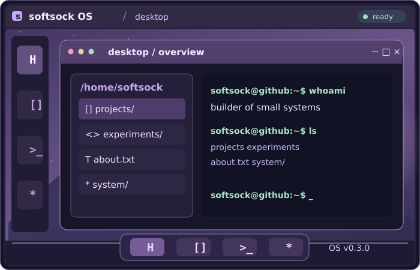
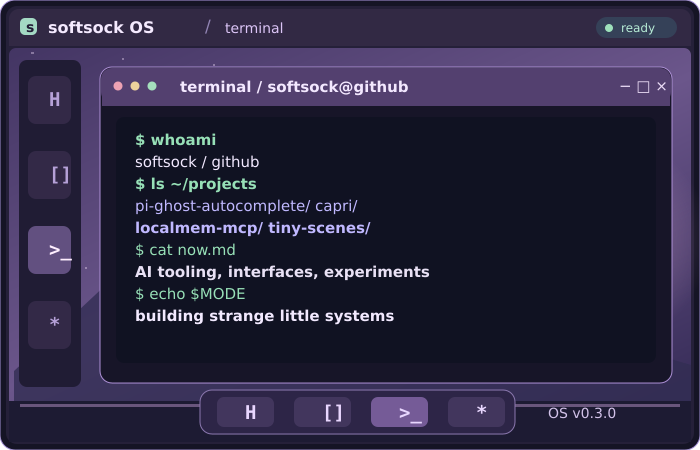
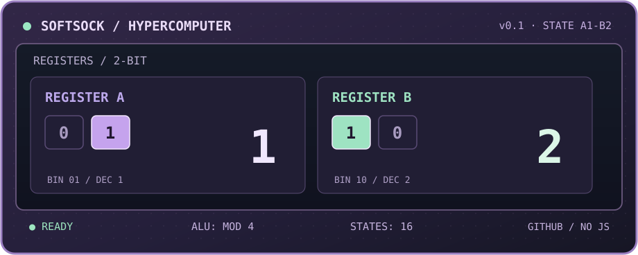

<!-- Generated by scripts/build.mjs. Edit the renderer and config/desktop.json. -->
<div align="center">

<h2>softsock OS <sub>v0.4.1</sub></h2>

<sub>profile edition · choose a window to explore</sub>

</div>

<details name="softsock-os" open>
<summary><kbd>⌂</kbd> <strong>Desktop</strong> &nbsp; <code>01 / HOME</code> &nbsp; <sub>~/workspace</sub></summary>




</details>

<details name="softsock-os">
<summary><kbd>▤</kbd> <strong>Files</strong> &nbsp; <code>02 / EXPLORER</code> &nbsp; <sub>~/projects</sub></summary>


<p align="right"><a href="#public-projects">Browse public projects ↓</a></p>
</details>

<details name="softsock-os">
<summary><kbd>&gt;_</kbd> <strong>Shell</strong> &nbsp; <code>03 / TERMINAL</code> &nbsp; <sub>softsock@github:~</sub></summary>



<p align="right"><a href="#profile-files">Read text files ↓</a></p>
</details>

<details name="softsock-os">
<summary><kbd>⚙</kbd> <strong>System</strong> &nbsp; <code>04 / ABOUT</code> &nbsp; <sub>/etc/softsock</sub></summary>


<p align="right"><a href="#profile-files">Open profile files ↓</a></p>
</details>

<p align="center"><sub>One screen at a time · select another window to switch · GitHub-native HTML</sub></p>

---

### Hypercomputer

<sub>v0.1 · the smallest computer that should not work in a GitHub README</sub>

<div align="center">

</div>

**Execute a command (starts from A=1, B=2):**

[**INC A**](./hypercomputer/states/a2-b2.md) &nbsp; · &nbsp; [**DEC B**](./hypercomputer/states/a1-b1.md) &nbsp; · &nbsp; [**ADD**](./hypercomputer/states/a3-b2.md) &nbsp; · &nbsp; [**SWAP**](./hypercomputer/states/a2-b1.md) &nbsp; · &nbsp; [**RESET**](./hypercomputer/states/a0-b0.md)

[Open the machine and continue computing](./hypercomputer/states/a1-b2.md) · [How it works](./hypercomputer/README.md)

<sub>Clicking a command navigates to its precomputed state. Within the state page you can keep computing. No JavaScript, no Issues, no server.</sub>

---

### public-projects

<details>
<summary><b>~/home/softsock/projects/</b> · public directories</summary>

| folder | description |
| :-- | :-- |
| [`pi-ghost-autocomplete/`](https://github.com/SheetHappiness/pi-ghost-autocomplete) | inline suggestions for the Pi terminal |
| [`capri/`](https://github.com/SheetHappiness/capri) | desktop-companion experiments |
| [`localmem-mcp/`](https://github.com/SheetHappiness/localmem-mcp) | memory tooling experiments |
| [`tiny-scenes/`](https://github.com/SheetHappiness/tiny-scenes) | small visual experiments |

</details>

### profile-files

<details>
<summary><b>about.txt</b></summary>

```txt
user: softsock
host: github
mode: building strange little systems
AI tooling, experimental interfaces, automation and small things that feel alive.
```

</details>

<details>
<summary><b>stack.json</b></summary>

```json
{
  "focus": ["agent tooling","experimental interfaces","creative software"],
  "interests": ["AI agents", "automation", "interface design"],
  "runtime": "GitHub-flavored Markdown"
}
```

</details>

<details>
<summary><b>contact.link</b></summary>

[github.com/SheetHappiness](https://github.com/SheetHappiness)

</details>
