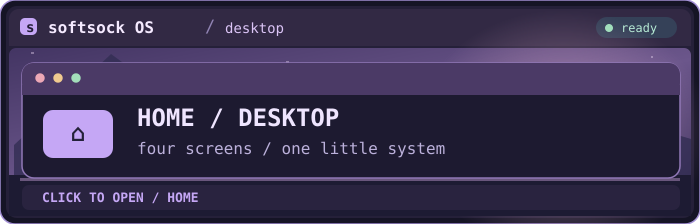
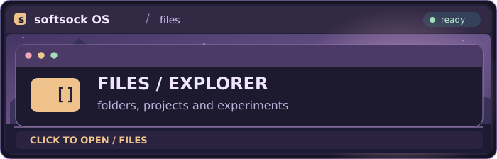
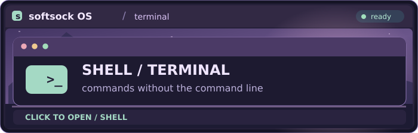
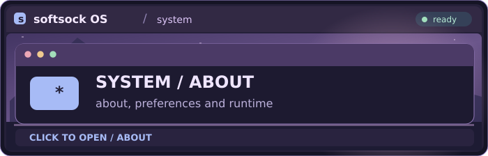
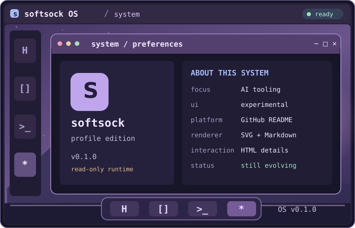

<!-- Generated by scripts/build.mjs; edit config/desktop.json or the renderer, not this file. -->
<div align="center">

<h2>softsock OS <sub>v0.1.0</sub></h2>
<sub>select a screen to explore / click another to switch</sub>

</div>

<table width="100%">
<tr>
<td width="50%" valign="top">
<details name="softsock-os" open>
<summary><b>Desktop / 01</b></summary>


</details>
</td>
<td width="50%" valign="top">
<details name="softsock-os">
<summary><b>Files / 02</b></summary>

<p><a href="#public-projects">Browse real repositories ↓</a></p>
</details>
</td>
</tr>
<tr>
<td width="50%" valign="top">
<details name="softsock-os">
<summary><b>Shell / 03</b></summary>

<p><a href="#profile-files">Inspect shell outputs ↓</a></p>
</details>
</td>
<td width="50%" valign="top">
<details name="softsock-os">
<summary><b>System / 04</b></summary>

<p><a href="#profile-files">Read profile files ↓</a></p>
</details>
</td>
</tr>
</table>

<p align="center"><sub>Read-only desktop. Screens expand with native HTML, not JavaScript.</sub></p>

---

### public-projects

<details>
<summary><b>~/home/softsock/projects/</b> · public directories</summary>

| folder | description |
| :-- | :-- |
| [`pi-ghost-autocomplete/`](https://github.com/SheetHappiness/pi-ghost-autocomplete) | inline suggestions for the Pi terminal |
| [`capri/`](https://github.com/SheetHappiness/capri) | desktop-companion experiments |
| [`localmem-mcp/`](https://github.com/SheetHappiness/localmem-mcp) | memory tooling experiments |
| [`tiny-scenes/`](https://github.com/SheetHappiness/tiny-scenes) | small visual experiments |

</details>

### profile-files

<details>
<summary><b>about.txt</b></summary>

```txt
user: softsock
host: github
mode: building strange little systems
AI tooling, experimental interfaces, automation and small things that feel alive.
```

</details>

<details>
<summary><b>stack.json</b></summary>

```json
{
  "focus": ["agent tooling","experimental interfaces","creative software"],
  "interests": ["AI agents", "automation", "interface design"],
  "runtime": "GitHub-flavored Markdown"
}
```

</details>

<details>
<summary><b>contact.link</b></summary>

[github.com/SheetHappiness](https://github.com/SheetHappiness)

</details>
