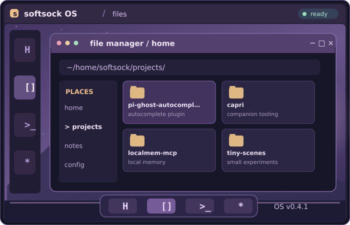

<!-- Generated by scripts/build.mjs. Edit the renderer and config/desktop.json. -->
<div align="center">

<h2>softsock OS <sub>v0.4.0</sub></h2>

<sub>profile edition · choose a window to explore</sub>

</div>

<details name="softsock-os" open>
<summary>

</summary>


</details>

<details name="softsock-os">
<summary>

</summary>



<p align="right"><a href="#public-projects">Browse public projects ↓</a></p>
</details>

<details name="softsock-os">
<summary>

</summary>


<p align="right"><a href="#profile-files">Read text files ↓</a></p>
</details>

<details name="softsock-os">
<summary>

</summary>


<p align="right"><a href="#profile-files">Open profile files ↓</a></p>
</details>

<p align="center"><sub>One screen at a time · click a different image to switch · GitHub-native HTML</sub></p>

---

### public-projects

<details>
<summary><b>~/home/softsock/projects/</b> · public directories</summary>

| folder | description |
| :-- | :-- |
| [`pi-ghost-autocomplete/`](https://github.com/SheetHappiness/pi-ghost-autocomplete) | inline suggestions for the Pi terminal |
| [`capri/`](https://github.com/SheetHappiness/capri) | desktop-companion experiments |
| [`localmem-mcp/`](https://github.com/SheetHappiness/localmem-mcp) | memory tooling experiments |
| [`tiny-scenes/`](https://github.com/SheetHappiness/tiny-scenes) | small visual experiments |

</details>

### profile-files

<details>
<summary><b>about.txt</b></summary>

```txt
user: softsock
host: github
mode: building strange little systems
AI tooling, experimental interfaces, automation and small things that feel alive.
```

</details>

<details>
<summary><b>stack.json</b></summary>

```json
{
  "focus": ["agent tooling","experimental interfaces","creative software"],
  "interests": ["AI agents", "automation", "interface design"],
  "runtime": "GitHub-flavored Markdown"
}
```

</details>

<details>
<summary><b>contact.link</b></summary>

[github.com/SheetHappiness](https://github.com/SheetHappiness)

</details>
