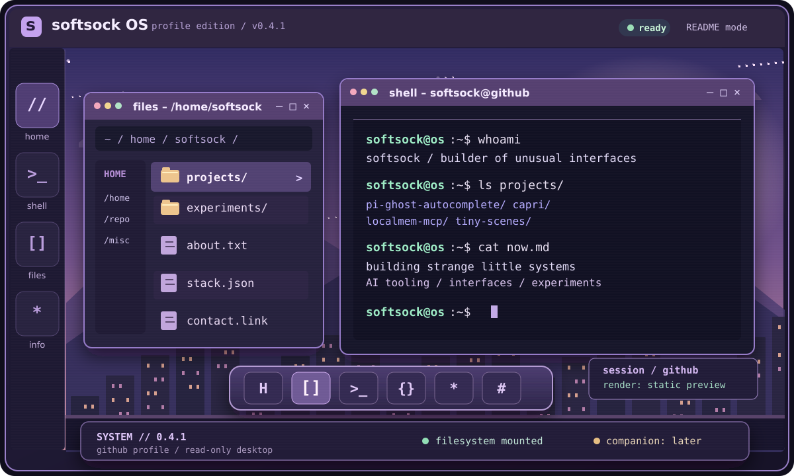

<!-- Generated by scripts/build.mjs. Edit config/desktop.json and rerun the generator. -->
<div align="center">



<sub>softsock OS · profile edition · v0.1.0</sub>

</div>

<p align="center">
  <a href="#abouttxt">about.txt</a> &nbsp;·&nbsp;
  <a href="#projects">projects/</a> &nbsp;·&nbsp;
  <a href="#stackjson">stack.json</a> &nbsp;·&nbsp;
  <a href="#contactlink">contact.link</a>
</p>

---

### about.txt

```txt
user: softsock
host: github
mode: building strange little systems

AI tooling, experimental interfaces, automation and small things that feel alive.
```

### projects/

<details open>
<summary><b>~/home/softsock/projects</b> · public folders</summary>

| folder | description |
| :-- | :-- |
| [`pi-ghost-autocomplete/`](https://github.com/SheetHappiness/pi-ghost-autocomplete) | inline suggestions for the Pi terminal |
| [`capri/`](https://github.com/SheetHappiness/capri) | desktop-companion experiments |
| [`localmem-mcp/`](https://github.com/SheetHappiness/localmem-mcp) | memory tooling experiments |
| [`tiny-scenes/`](https://github.com/SheetHappiness/tiny-scenes) | small visual experiments |

</details>

### stack.json

```json
{
  "focus": ["agent tooling","experimental interfaces","creative software"],
  "interests": ["AI agents", "automation", "interface design"],
  "environment": "experiments first"
}
```

### contact.link

[github.com/SheetHappiness](https://github.com/SheetHappiness)

<sub>Desktop rendered as a GitHub-safe SVG. Navigation uses real Markdown links because scripts cannot run inside a profile README.</sub>

<!-- END softsock OS -->
