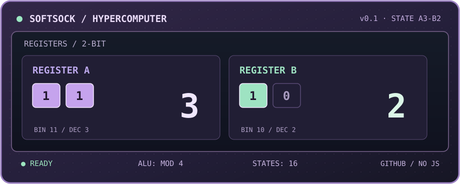

<!-- Generated by scripts/hypercomputer.mjs. Do not edit this state manually. -->

<h1>softsock Hypercomputer · v0.1</h1>

<strong>STATE A3-B2</strong> · 2-bit registers · 16 possible states

## Execute an instruction

Select an instruction below. GitHub will open another Markdown state page.

| Instruction | Operation | Next state |
| :-- | :-- | :-- |
| [**INC A**](a0-b2.md) | Increment A (modulo 4) | `A=0, B=2` |
| [**DEC B**](a3-b1.md) | Decrement B (modulo 4) | `A=3, B=1` |
| [**ADD**](a1-b2.md) | A = (A + B) modulo 4 | `A=1, B=2` |
| [**SWAP**](a2-b3.md) | Exchange A and B | `A=2, B=3` |
| [**RESET**](a0-b0.md) | Set both registers to zero | `A=0, B=0` |

**A = 3** (`11`) · **B = 2** (`10`) · all arithmetic modulo 4.

[↩ Back to profile](../../README.md#hypercomputer) · [Reset machine](a0-b0.md) · [Source code](../../scripts/hypercomputer.mjs)

How can Markdown behave like a computer?

Every possible register pair (`0..3`, `0..3`) is generated in advance. A click follows a link to the corresponding precomputed Markdown page. No JavaScript, Issues, GitHub Actions at click time or external backend. There are only 16 states, so **this is a finite-state machine, not a general-purpose CPU**.

